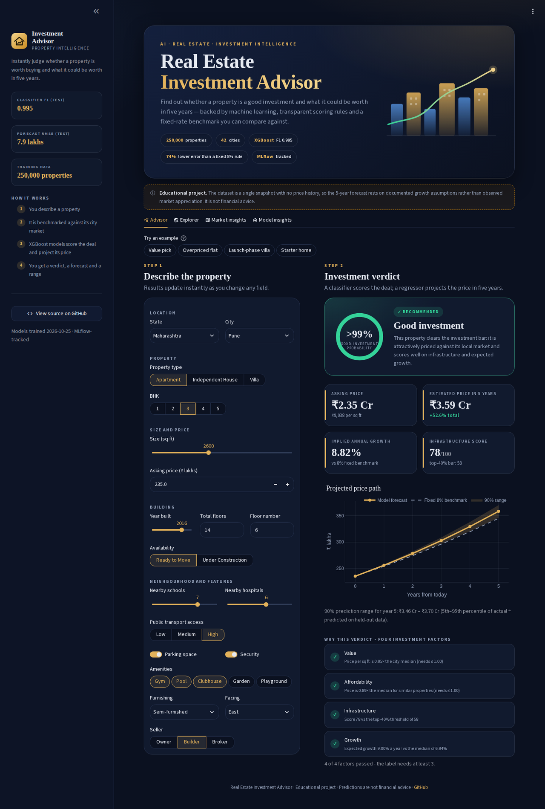
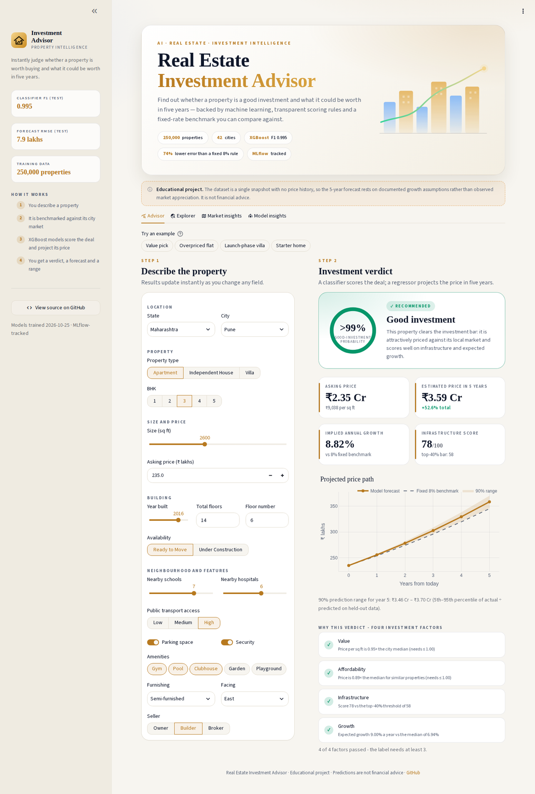
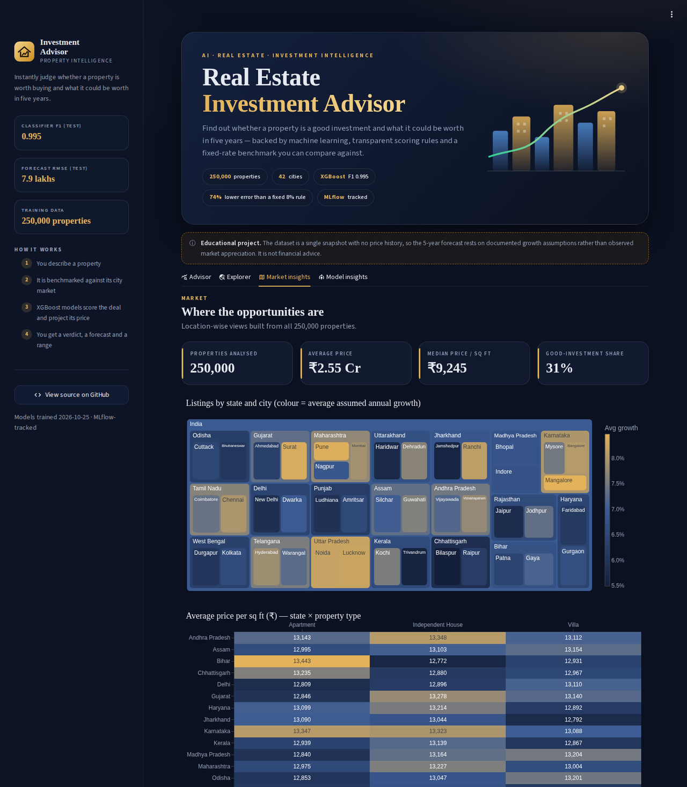
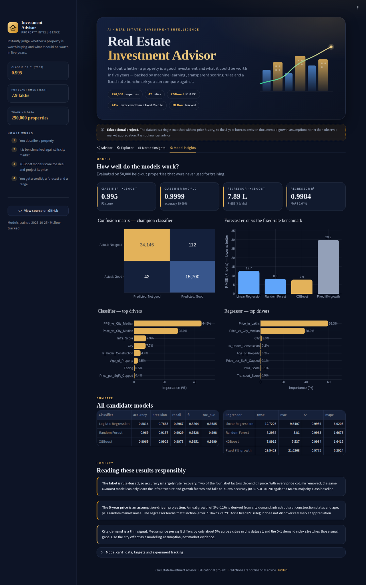

<div align="center">

# Real Estate Investment Advisor

**Predicting Property Profitability & Future Value in the Indian Housing Market**

An end-to-end supervised learning project that classifies whether a property is a **Good Investment** and forecasts its **price after 5 years** — with MLflow experiment tracking and a premium, theme-aware Streamlit app.

**[Live App →](real-estate-investment-advisor-app.streamlit.app)**

</div>

---

## Preview

| Advisor (dark) | Advisor (light) |
|---|---|
|  |  |

| Market insights | Model insights |
|---|---|
|  |  |

---

## Overview

This project analyzes **250,000 property listings** across **20 states and 42 cities** in India to:

1. **Classify** whether a property is a *Good Investment* (binary classification from a transparent four-factor rule score).
2. **Forecast** the estimated *property price after 5 years* (regression with a feature-based growth rate and a fixed-rate benchmark).
3. **Track** every experiment with **MLflow** (parameters, metrics, figures, fitted pipelines, model registry).
4. **Serve** both models through an interactive **Streamlit** app with investment verdicts, forecasts, 90% prediction ranges, location-wise heatmaps, model confidence and feature importance.

---

## Data Pipeline

The raw dataset (250,000 rows, 23 columns) was validated and cleaned as follows:

| Step | Action | Result |
|---|---|---|
| 1 | Schema validation (required columns, readable CSV) | Clear errors for missing / empty / corrupt files |
| 2 | Stripped whitespace, converted empty strings to nulls | Consistent categories |
| 3 | Dropped duplicate listings (ignoring `ID`) | 0 removed |
| 4 | Dropped rows with unusable price / size / BHK / year | 0 removed |
| 5 | Imputed remaining gaps (median / mode) | 0 cells |
| 6 | Enforced business rules (positive price, size, BHK, floors; year ≤ 2025) | 0 removed |
| 7 | Recomputed `Age_of_Property` = 2025 − `Year_Built` | 0 corrected |
| 8 | Capped impossible floors (`Floor_No` > `Total_Floors`) and added a flag | **116,304 rows (46.5%)** corrected |
| 9 | Rebuilt price per sq ft in rupees (source column was rounded to 2 decimals of lakhs) | `Price_per_SqFt_INR` |
| 10 | Winsorized price per sq ft at the 1st / 99th percentile for scale-sensitive models | `Price_per_SqFt_Capped` |

**Result: 250,000 clean rows.** The file had no nulls or duplicates, but its quality problems were hidden in the values.

---

## Exploratory Data Analysis

All **20 EDA questions** from the project brief are answered in the notebook with charts and data-driven insights. The headline findings:

| Topic | Finding |
|---|---|
| Price & size distribution | Both are **uniform**: each of five equal price bands holds 19.9%–20.3% of properties |
| Size vs price | Correlation is **-0.003** — larger homes are not pricier |
| Property type | Median price per sq ft differs by only 1.2% between Apartment, Villa and House |
| State / city | Average price per sq ft varies 2.5% across states; average price 3.0% across cities |
| BHK mix | Every BHK type is 18.6%–22.0% of listings in every city |
| Schools / hospitals vs price | Correlation with price per sq ft: -0.000 / -0.000 |
| Furnishing, parking | Furnishing spread 0.3%; parking premium +0.12% |
| Outliers | Only price per sq ft has IQR outliers (tiny flats with large price tags) — winsorized |
| Transport vs investment potential | Good-investment share rises from 19.2% (Low) to 44.3% (High) — by construction of the rules |

> **Reading the findings:** price is statistically independent of size, BHK, city and property type, which is unrealistic for a real market. The project makes this explicit instead of hiding it.

---

## Feature Engineering & Targets

### Engineered features

`Price_per_SqFt_INR`, `PPS_vs_City_Median`, `Price_vs_City_Median`, `School_Density_Score`, `Transport_Score`, `Amenity_Count` + one flag per amenity, `Infra_Score` (0–100), `Floor_Ratio`, `Size_per_BHK`, `City_Demand_Index`, `Is_Under_Construction`.

### Classification target — `Good_Investment`

A property earns one point per factor and is **good when it earns at least 3 of 4**:

| Factor | Rule |
|---|---|
| Value | Price per sq ft ≤ city median |
| Affordability | Price ≤ median price for the same city and property type |
| Infrastructure | `Infra_Score` ≥ 57.5 (top 40%) |
| Growth | Expected annual growth ≥ 6.94% (median) |

Class balance: **31.5% good investments** (handled with class weights).

### Regression target — `Future_Price_5Y`

`Future_Price_5Y = Price × (1 + r)^5` with `r = 0.045 + 0.030·CityDemand + 0.020·Infra/100 + 0.008·UnderConstruction − 0.0005·max(Age−10, 0) + noise`, clipped to 3%–12%. The brief's fixed 8% rate is kept as a **benchmark**. All assumptions live in `src/config.py`.

> The dataset is a single snapshot with no price history, so the 5-year price is a **documented simulation**, not observed appreciation.

---

## Model Comparison

Evaluated on **50,000 held-out properties** (80/20 stratified split, fixed seed).

### Classification — Good Investment

| Model | Accuracy | Precision | Recall | F1 | ROC-AUC |
|---|---|---|---|---|---|
| Logistic Regression | 0.8814 | 0.7663 | 0.8967 | 0.8264 | 0.9585 |
| Random Forest | 0.9690 | 0.9157 | 0.9929 | 0.9528 | 0.9980 |
| **XGBoost** | 0.9969 | 0.9929 | 0.9973 | **0.9951** | 0.9999 |

### Regression — Price after 5 years (₹ lakhs)

| Model | RMSE ↓ | MAE ↓ | R² ↑ | MAPE ↓ |
|---|---|---|---|---|
| Linear Regression | 12.723 | 9.641 | 0.9959 | 6.02% |
| Random Forest | 8.296 | 5.810 | 0.9983 | 1.67% |
| **XGBoost** | **7.891** | 5.537 | 0.9984 | 1.64% |
| Fixed 8% growth (benchmark) | 29.942 | 21.627 | 0.9775 | 6.29% |

**Champions: XGBoost (classification) and XGBoost (regression).** XGBoost was tuned with a randomized search (6 candidates × 3-fold CV). The regressor reduces RMSE by **74%** compared with the fixed 8% growth rule.

- Top classifier drivers: `PPS_vs_City_Median` (44.5%), `Price_vs_City_Median` (28.9%), `Infra_Score` (7.9%), `City` (7.7%)
- Top regressor drivers: `Price_in_Lakhs` (59.3%), `Price_vs_City_Median` (38.9%), `City` (1.0%)
- 90% prediction range: actual price lies between **0.966×** and **1.033×** the forecast on held-out data.

### Honesty checks

| Check | Result |
|---|---|
| Majority-class baseline accuracy | 68.5% |
| Classifier **without any price feature** | accuracy 71.9% · ROC-AUC 0.828 |
| Overfitting (train vs test F1) | 0.9999 vs 0.9951 — no meaningful gap |

Two of the four label factors depend on price, so the classifier's 99.69% accuracy largely reflects **recovering the labelling rules**. Without price features it can only learn the infrastructure and growth factors. The notebook also compares the regressor with an **oracle** that knows the exact noise-free growth formula to show how much error is irreducible market noise.

---

## MLflow Experiment Tracking

`python -m src.train` logs every run to a local SQLite-backed MLflow store:

- **Experiments:** `RealEstate_GoodInvestment_Classification` and `RealEstate_FuturePrice_Regression`
- **Per run:** hyper-parameters, test metrics, tags and the fitted scikit-learn pipeline (with signature)
- **Champion report runs:** confusion matrix, ROC curve, actual-vs-predicted, residuals and feature-importance figures
- **Model Registry:** `RealEstate_GoodInvestment_Classifier` and `RealEstate_FuturePrice_Regressor`, each with the alias `champion`

```bash
mlflow ui --backend-store-uri sqlite:///mlflow.db   # then open http://localhost:5000
```

---

## Streamlit App

| Tab | What it does |
|---|---|
| **Advisor** | Live form with one-click examples → verdict ring, 5-year price, implied growth, 90% range, price-path chart vs the 8% benchmark, factor-by-factor checklist, extrapolation warnings |
| **Explorer** | Filters 250,000 properties by state, city, type, BHK, price, size, availability; summary KPIs; shortlist table; CSV download |
| **Market insights** | State → city treemap, state × property-type heatmap, top cities, infrastructure-vs-growth bubbles, trend charts |
| **Model insights** | Champion metrics, confusion matrix, error vs benchmark, feature importance, all candidate models, honest interpretation, model card |

**Design:** custom midnight-and-gold (dark) and ivory-and-gold (light) design system on top of Streamlit's native theming (`.streamlit/config.toml`), serif headlines, responsive layout, and `st.fragment` so widget changes re-run only the active tab.

---

## Repository Structure

```
Real-Estate-Investment-Advisor/
├── .streamlit/
│   └── config.toml                  # premium light/dark theme
├── data/
│   ├── raw/india_housing_prices.csv
│   └── processed/                   # cleaned + engineered data and dashboard summaries
├── models/                          # trained pipelines, benchmark tables, metadata
├── reports/
│   ├── figures/                     # evaluation figures
│   └── screenshots/                 # app screenshots used in this README
├── src/
│   ├── config.py                    # paths, seeds, growth assumptions
│   ├── data_loader.py               # loading, validation, cleaning, outlier detection
│   ├── features.py                  # feature engineering, benchmarks, targets
│   ├── modeling.py                  # pipelines, evaluation, tuning, persistence
│   ├── train.py                     # end-to-end training with MLflow
│   ├── predict.py                   # inference service used by the app
│   ├── ui.py                        # design system (CSS, components, chart styling)
│   └── logger.py
├── tests/test_pipeline.py
├── app.py                           # Streamlit application
├── real-estate-investment-advisor.ipynb
├── requirements.txt                 # runtime (what Streamlit Cloud installs)
├── requirements-dev.txt             # + training, MLflow, notebook, tests
├── .gitignore
└── README.md
```

---

## Running Locally

```bash
git clone https://github.com/13msrajput/Real-Estate-Investment-Advisor.git
cd Real-Estate-Investment-Advisor
python -m venv .venv && source .venv/bin/activate     # Windows: .venv\Scripts\activate
pip install -r requirements-dev.txt   # app + training + MLflow + notebook + tests

python -m src.train            # optional: re-train models (adds --skip-tuning / --no-mlflow flags)
streamlit run app.py           # launch the app
pytest                         # run the tests
```

The trained artifacts (`classifier_pipeline.joblib`, `regressor_pipeline.joblib`, `reference_tables.json`, `model_metadata.json`) and the processed data are already included, so the app runs immediately. Requires **Python 3.11+** (developed on 3.12). The model files were created with the exact library versions pinned in `requirements.txt`; deploying the app (for example on Streamlit Community Cloud) only needs that lighter file.

---

## Tech Stack

- **Data / ML:** pandas, numpy, scikit-learn (Logistic / Linear Regression, Random Forest), XGBoost, joblib
- **Experiment tracking:** MLflow (SQLite backend, model registry)
- **Visualization:** matplotlib, seaborn, plotly
- **App:** Streamlit (native light/dark theming, fragments, column configs)
- **Quality:** pytest, structured logging, input validation and exception handling in every module

---

## Limitations

- No transaction dates → real appreciation cannot be learned; the 5-year price is an assumption-driven projection.
- Prices are independent of size, BHK, city and type in this dataset, so conclusions about real-world price drivers cannot be drawn.
- The city demand index stretches a ~5% spread in city median price per sq ft into a 0–1 scale.
- `Locality` holds generic labels repeated across cities and is not used.
- Educational project — **not financial advice**.

---

# Author

**MOHIT SINGH RAJPUT — AI/ML Engineer**

[](https://linkedin.com/in/13msrajput)
[](https://github.com/13msrajput)
[](https://www.kaggle.com/13msrajput)
[](https://leetcode.com/u/13msrajput)
[](mailto:mohitsinghrajput1307@gmail.com)

---

<div align="center">

*If this project was useful, a ⭐ on the repository is appreciated.*

</div>
